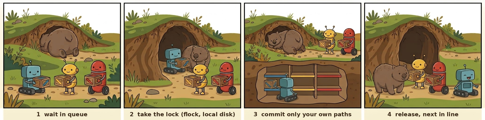

# 🐨 wombat-gate

<p align="center">
  
</p>

**Immer nur einer durch den Bau.** Eine Commit-Warteschlange für KI-Agenten, die sich ein
Git-Repository teilen: Sie warten, bis sie dran sind, und jeder committet nur seine eigenen Dateien.

🌐 [English](https://github.com/liyifreddy/wombat-gate/blob/main/README.md) · **Deutsch** · [中文](https://github.com/liyifreddy/wombat-gate/blob/main/README.zh-CN.md)

## 🚀 Schnellstart

```sh
pipx install git+https://github.com/liyifreddy/wombat-gate

wombat-gate commit -m "fix parser" -- src/parser   # commit only these paths, in turn
wombat-gate run -- git push                        # push
wombat-gate who                                    # who is in the burrow
```

Eine Datei, Python ≥ 3.8, nur die Standardbibliothek. Linux, macOS und WSL.

In Claude Code installierst du das Plugin (CLI + Guard-Hook + Regeln für den Agenten):

```
/plugin marketplace add liyifreddy/wombat-gate
/plugin install wombat-gate@wombat-gate
```

## 😩 Das Problem

Setzt man ein paar Claude-Code-Sessions (oder beliebige Agenten) in einen Checkout, passiert schnell Folgendes:

- 🧺 **Commits nehmen fremde Dateien mit.** `git add -A`, `git commit -a` oder ein nacktes
  `git commit` greift alles auf, was ein Nachbar gestaged hat. Das ist uns an zwei Tagen
  zweimal passiert.
- 🥊 **Lock-Kämpfe.** Jeder Schreibzugriff auf den Index braucht `.git/index.lock`; der zweite Agent
  bekommt `index.lock: File exists`. In unserem Selbsttest kamen bei 8 Schreibern × 15 Commits
  nur 1–10 von 120 durch.
- 🐢 **Jeder Commit prüft den ganzen Baum.** Bei unserem Repo mit 22k Dateien auf einem
  per WSL eingebundenen Windows-Laufwerk dauerte ein Commit 30–70 s, und eine volle Warteschlange
  wartete 6 Minuten. Wird der Speicher knapp, scheitert diese Flut an Plattenzugriffen zuerst
  und reißt das Laufwerk mit.
- 💣 **Befehle für den ganzen Baum.** Agenten greifen zu `git stash`, `git reset --hard`,
  `git checkout -- .` und werfen gegenseitig ihre Arbeit weg.

<p align="center">
  
</p>
<p align="center"><sub>Vorher: alle gleichzeitig im Bau. Nachher: einer nach dem anderen, jede Kiste im eigenen Regal.</sub></p>

## ✨ Was du bekommst

- ✅ **Deine Pfade, sonst nichts.** `wombat-gate commit -m MSG -- PATH...` committet genau
  diese Pfade. Was andere gestaged haben, bleibt unberührt.
- ✅ **Eine Warteschlange statt Fehlern.** Alle warten auf ein Lock und kommen der Reihe nach dran.
  Selbsttest: 120 von 120 Commits landen; Median der Wartezeit 0,14 s auf einer unbelasteten Maschine.
- ✅ **Kein Scan des ganzen Baums.** Nur deine Pfade werden angefasst. Das Repo mit 22k Dateien
  sank beim ersten echten Commit von 30–70 s auf 3 s.
- ✅ **Ein Guard-Hook**, der Git-Befehle für den ganzen Baum in Claude Code stoppt (an 197 Befehlen getestet).
- ✅ **Fremde Locks bleiben unangetastet.** Hält ein anderer Git-Prozess eines, wartet wombat-gate und versucht es erneut.
- ✅ **Räumt hinter sich auf.** Wird ein wombat-gate beendet, während es `index.lock` hält, erkennt der nächste
  Commit die eigene Hinterlassenschaft und entfernt sie. Das Lock eines anderen wird nur gemeldet:
  `wombat-gate doctor` sagt, wie alt es ist, wer es geöffnet hat und was zu tun ist.
- ✅ **Ein Timing-Log**: Wartezeit in der Queue, Lock-Haltedauer und jeder Git-Schritt, eine JSON-Zeile pro Commit.
- ✅ **Installation mit einer Zeile** als Claude-Code-Plugin, mit Hook und einem Skill, der
  dem Agenten die Regeln beibringt.

## 🕳️ Warum ein Wombat

Wird ein Wombat gejagt, flüchtet er in seinen Bau und verstopft den Eingang mit seinem Hinterteil –
einer harten Knochenplatte, die kein Fuchs durchbeißt. Ein Wombat pro Bau; alle anderen
warten draußen. (Wombats setzen außerdem würfelförmigen Kot auf Felsen, um *mein* zu sagen. Bei unseren
Verzeichnissen empfinden wir genauso.)

```
  agent A ──┐                                      ┌──▶ commit A's paths only
  agent B ──┼──▶ queue ──▶ take lock ──▶ write ────┤
  agent C ──┘    (wait)    (local disk)            └──▶ release ──▶ next in line
```

<p align="center">
  
</p>

(Die Beschriftung im Bild ist englisch.)

1. **In der Schlange warten** – die Agenten stellen sich draußen an.
2. **Das Lock nehmen** – einer geht hinein. Das Lock liegt unter `~/.local/state`, außerhalb des
   Repos, auf einer lokalen Platte (wombat-gate warnt, falls nicht).
3. **Nur die eigenen Pfade committen** – er stellt seine eigene Kiste ab und sonst nichts.
4. **Freigeben, der Nächste bitte** – er kommt heraus; der Nächste geht hinein.

<p align="center"><sub>Illustrationen mit Google Gemini erzeugt und vom Autor nachbearbeitet.</sub></p>

## 🧭 Unter der Haube

- **Keine hängenden Locks.** Stirbt der Halter, gibt der Kernel das Lock frei. Nichts aufzuräumen.
- **Pfadprüfungen.** `.`, das Repo-Root, Globs und `:`-Pathspecs werden abgelehnt, damit niemand
  versehentlich den ganzen Baum committet.
  Ein benanntes Verzeichnis mit mehr als 200 geänderten Dateien (`WOMBAT_MAX_DIR_FILES`) wird
  ebenfalls abgelehnt (ein gelöschtes Verzeichnis zählt mit, und ein Rename zählt beide Enden, wie bei `--dry-run`).
  Ein Mensch kann `--confirm-large` übergeben; ein Agent (`CLAUDECODE` usw. gesetzt) kann das nicht, ebenso wenig
  wie `--allow-broad`, und nutzt `--expect-files N` mit der Anzahl aus einer `--dry-run`-Durchsicht
  (ein bloßes `--dry-run` wird ebenfalls abgelehnt; nimm `--dry-run --expect-files N`). Ein leerer Pfad
  (eine ungesetzte Variable) wird abgelehnt, und bei einem Pfad in einem anderen Repository steht, zu
  welchem er gehört. `release --as NAME --` ohne etwas nach `--` wird abgelehnt, statt
  alles freizugeben.
- **Warum es schnell ist.** Deine Pfade werden in einer privaten Kopie des Index gestaged und auf
  `HEAD` aufgepfropft. Der Branch bewegt sich nur, wenn ihn niemand sonst bewegt hat, und Gits eigenes
  Index-Lock wird die ganze Zeit gehalten. Jeder Selbsttest-Lauf vergleicht das Ergebnis mit einem normalen `git commit`.
- **Status nur für deine Pfade**: `wombat-gate status -- PATH...`.
- **Nur für Menschen gedachte Flags** (`--allow-broad`, `run --unsafe`) werden innerhalb von Agenten abgelehnt.

Die Schritt-für-Schritt-Fassung steht in der [Referenz](REFERENCE.md).

## 🛠️ Verwendung

```sh
wombat-gate commit -m "parser: handle empty input" -- src/parser tests/test_parser.py
wombat-gate commit -n -m "..." -- src/parser   # dry run
wombat-gate status -- src/parser               # status of your paths only
wombat-gate run -- git push                    # push, fetch, tag, log, ... (an allow-list)
wombat-gate who                                # who is in the burrow
wombat-gate log -n 50                          # recent timings (--stats: p50 / p95)
wombat-gate doctor                             # git lock files: in use, stale, or ours
wombat-gate claim --as agent-7 -- src/parser   # reserve your paths at start; overlaps are refused (exit 7)
wombat-gate claims                             # who reserved what, and the isolated worktrees
wombat-gate release --as agent-7               # hand the paths back when you are done
wombat-gate isolate --as agent-7               # your own worktree + branch beside the repo
wombat-gate integrate --as agent-7 --check 'make test' --done   # rebase, check, fast-forward, clean up
```

Setze `WOMBAT_SESSION=agent-7` (oder `--session` / `--as`), damit `who` anzeigen kann, wer gerade drin ist.

## 🔀 Drei Arbeitsweisen: welche wann (0.9)

| Deine Situation | Nimm | Was passiert |
|---|---|---|
| Kleine Änderungen, Agenten an verschiedenen Dateien, ein gemeinsamer Checkout | nur `commit -- <paths>` | Commits laufen durch ein Lock in die Queue; jeder nimmt nur seine eigenen Pfade. |
| Agenten parallel an **getrennten** Teilen eines Checkouts | `claim` am Anfang, `release` am Ende | Der zweite Agent, der einen überlappenden Pfad beansprucht (gleicher Pfad oder ein Eltern-/Kindverzeichnis), erfährt sofort, wer ihn hält, und bekommt Exit-Code 7 – bevor jemand eine Zeile schreibt. `commit` vermerkt Pfade außerhalb deiner Claims. |
| Agenten parallel am **selben** Code | `isolate`, dann `integrate --done` | Jeder Agent bekommt einen eigenen Worktree und Branch neben dem Repo. Die Übergabe rebased auf das aktuelle Ziel, führt deine Checks aus, macht einen Fast-Forward und entfernt dann den Worktree und den gemergten Branch. Ein Konflikt bleibt im Worktree dieses Agenten stehen und listet die Dateien auf. |

**Im Vergleich zu „ein Worktree pro Agent"** (was OpenCode, Codex und ähnliche Tools bieten): Deren Worktrees halten die Agenten während der Arbeit auseinander, und die Kollision zeigt sich erst beim Merge. wombat-gate ergänzt drei Dinge:

1. **Überlappung wird am Anfang gemeldet.** `claim` (und `isolate -- <paths>`) prüft die Reservierungen jeder aktiven Session über alle Worktrees des Repositorys, sodass zwei Agenten, die auf dasselbe Verzeichnis zusteuern, es vor dem Start erfahren, nicht erst beim Mergen.
2. **Die Übergabe wird geprüft.** `integrate` rebased auf das Ziel, wie es *jetzt* ist, führt die geforderten Checks aus und macht nur dann einen Fast-Forward, wenn sich das Ziel seitdem nicht bewegt hat; hat es sich bewegt, wird erneut rebased und geprüft (`--attempts`, Standard 3). Die Queue wird nur kurz am Anfang und beim Fast-Forward gehalten, sodass andere Agenten während langer Checks weiter committen können.
3. **Das Aufräumen ist automatisch und sicher.** `--done` entfernt den Worktree und löscht den Branch nur, wenn der Branch gemergt und der Worktree sauber ist; nichts wird erzwungen.

Reservierungen einer Session, deren Agent-Prozess beendet ist, werden beim nächsten Hinsehen verworfen; isolierte Worktrees werden nie automatisch verworfen (sie könnten Arbeit enthalten) – `claims` markiert ihren Besitzer als verschwunden.
Exit-Codes, Einstellungen und jeder abgelehnte Befehl stehen in der [Referenz](REFERENCE.md).

## 🤖 Mit Claude Code

1. Installiere das Plugin (siehe [Schnellstart](#-schnellstart)). Es bringt die CLI, den Guard-Hook
   und einen Skill mit den Regeln mit.

2. Sag deinen Sessions die Regeln, z. B. in `CLAUDE.md`:

   > Commit with `wombat-gate commit -m "..." -- <your paths>`; push with
   > `wombat-gate run -- git push`. No `git add -A`, `git commit -a` or `git stash`.

   (Auf Deutsch: Committe mit `wombat-gate commit -m "..." -- <deine Pfade>`, pushe mit
   `wombat-gate run -- git push`. Kein `git add -A`, `git commit -a` und kein `git stash`.)

3. Markiere Claude Code in `.claude/settings.json` als Agent, damit die nur für Menschen gedachten Flags
   (`--allow-broad`, `run --unsafe`) gesperrt bleiben: `{ "env": { "WOMBAT_NO_ESCAPES": "1" } }`.

Viele Sessions im Einsatz? Das [Playbook](PLAYBOOK.md) behandelt Namensgebung, Task-Karten, Review-Ketten
und unbeaufsichtigte Läufe.

## ⚠️ Grenzen

- Nur Prozesse, die wombat-gate benutzen, reihen sich ein. Stelle alle Agenten darauf um.
- Das Lock muss auf einer lokalen Platte liegen. Git auf der Windows-Seite sieht kein WSL-Lock.
- Commits werden schnell; `git status` und `git log` auf einer langsamen Platte nicht.
- Zwei Agenten ändern dieselbe Datei in einem Checkout: Der erste Commit nimmt beide Änderungen mit.
  Gib den Agenten getrennte Pfade (`claim`) oder getrennte Worktrees (`isolate`).
- Claims sind unverbindlich: Sie warnen und lehnen überlappende Claims ab, verhindern aber keinen Commit.
- Nur eine Maschine.

Die vollständige Liste steht in der [Referenz](REFERENCE.md#limits-in-full).

## ✅ Selbsttest

```sh
python3 selftest_wombat_gate.py               # 1–7 min depending on load, throw-away repos on a local disk
python3 selftest_wombat_gate.py --mutants     # 44 past bugs put back; each must turn a check red
bash hooks/selftest_guard.sh                  # 197 commands the guard must block or let through
python3 selftest_release.py                   # 0.8 regressions: deletions, renames, integrate (25)
python3 selftest_isolate.py                   # 0.9: claims, isolated worktrees, integrate without holding the queue, path guards (39)
```

Jeder schnelle Commit wird mit dem verglichen, was ein normales `git commit` auf einer Kopie des Repos tut.

## 📍 Status

- 0.9.1 Kandidat – lehnt leere Pfade und große benannte Verzeichnisse ab und sagt, zu welchem Repository ein Pfad außerhalb gehört.
- 0.9.0 Kandidat – `claim` / `release` / `claims`, `isolate`-Worktrees mit `integrate --done`, und `integrate` hält die Queue beim Rebase und bei den Checks nicht mehr.
- 0.8.0 – Unterstützung für gestagte Löschungen/Renames, geprüfte Dateianzahlen sowie geprüfte Worktree-Integration und Release-Checks. Siehe [CHANGELOG](CHANGELOG.md).

- 0.7.0 – räumt sein eigenes veraltetes `index.lock` auf; `doctor`; Timing p50 / p95.
- 0.6.2 – Vorher-/Nachher-Bild, Sprachumschalter.
- 0.6.1 – illustriertes README, ein winziger Wombat in `--help`, pipx-Paketierung, PyPI-Workflow.
- 0.6.0 – schnelle Commits (privater Index + Tree-Graft + Compare-and-Swap).

Wie es gebaut ist und warum: [DESIGN.md](DESIGN.md).

## 📄 Lizenz

MIT – siehe [LICENSE](LICENSE).

## Gestagte Löschungen, Renames und geprüfte Anzahlen (0.8)

Nenne bei einem Rename sowohl den alten als auch den neuen Pfad, auch wenn `git mv` oder `git rm` die Änderung bereits gestaged hat. HEAD-Einträge, die im Index fehlen, werden als Löschungen behandelt, wenn der Pfad auch auf der Platte fehlt. Ein Pfad, der noch auf der Platte liegt, wird wie bisher von der Platte gestaged.

```sh
wombat-gate commit -n --expect-files 2 -m 'rename notes' -- '旧目录/笔记.md' 'notes.md'
wombat-gate commit    --expect-files 2 -m 'rename notes' -- '旧目录/笔记.md' 'notes.md'
```

Die Vorschau zeigt eine Zeile pro geändertem **Pfad**, wobei beide Enden eines Renames in getrennten Zeilen stehen. Dateinamen sind JSON-quotiertes UTF-8, sodass eingebettete Zeilenumbrüche keine zusätzlichen Zeilen erzeugen können. Die Zusammenfassung `删 N / 改名 N / 改 N` bedeutet: gelöschte Pfade ohne Rename-Quellen / Rename-Paare / sonstige geänderte Pfade (einschließlich Neuanlagen). Ein Rename sind zwei Zeilen, aber ein Paar. `--expect-files N` prüft die Anzahl unter dem Queue-Lock erneut und lehnt Abweichungen ab (Exit 2); verwende bei einem Verschieben die Zahl der ausdrücklich benannten geänderten Dateien. Verzeichnisse werden rekursiv aufgelöst, nimm also die aufgelöste Dateianzahl statt der Zahl der Verzeichnisargumente. Ohne das Flag bleibt die ursprüngliche rekursive Commit-API verfügbar. Das Staging anderer Agenten liegt außerhalb der gewählten Pfade.

## Einen Worktree-Branch integrieren

Rebase vom **Ziel**-Worktree aus den committeten Quell-Branch auf den aktuellen Ziel-HEAD, führe die genannten Checks im Quell-Worktree aus und mache dann einen Fast-Forward:

```sh
wombat-gate integrate -n --rebase topic --check 'python3 tests/run_all.py'
wombat-gate integrate    --rebase topic --check 'python3 tests/run_all.py' --check 'python3 tests/regression.py'
wombat-gate integrate    --as agent-7   --check 'python3 tests/run_all.py' --done   # a worktree made by isolate
```

Die Quelle muss bereits in einem separaten Worktree ausgecheckt sein und darf keine getrackten Änderungen oder nicht ignorierten untracked Dateien haben. Mindestens ein `--check` ist erforderlich. Befehle werden ohne Shell in argv zerlegt: keine Pipes, keine Umleitung, keine Shell-Expansion; `--check-timeout` beträgt standardmäßig 600 Sekunden pro Befehl. Die gemeinsame Queue des Repositorys wird zweimal kurz gehalten: um das Ziel zu validieren und zu notieren, und um den Fast-Forward zu machen, sobald feststeht, dass sich das Ziel nicht verändert hat. Rebase und Checks laufen außerhalb davon, sodass andere Sessions weiter committen können; hat sich das Ziel inzwischen bewegt, rebased und prüft integrate erneut, bis zu `--attempts` (Standard 3, oder `WOMBAT_INTEGRATE_ATTEMPTS`). Das Ziel darf unabhängige gestagte/ungestagte Arbeit enthalten; überlappende getrackte, untracked oder ignorierte Pfade werden abgelehnt. Ignorierte Quelldateien, die Änderungen des Ziels überschreiben würden, werden ebenfalls abgelehnt. Checks müssen den Quell-HEAD und die getrackten/nicht ignorierten Dateien unverändert lassen.

Konflikte bleiben im Quell-Worktree stehen, der Rebase-Zustand bleibt erhalten; sieh dir ihn dort an und setze ausdrücklich fort oder brich ab, bevor du es erneut versuchst. Fehlgeschlagene Checks lassen den rebasten Quell-Branch bestehen und bringen das Ziel nicht voran. Quell-Branches mit Merge-Commits erfordern eine manuelle Prüfung. Ein Ziel, das über das Versuchslimit hinaus in Bewegung bleibt, ein Ziel, das den Branch gewechselt hat, eine laufende Operation oder eine unsichere Überlappung beenden die Integration. Es gibt kein automatisches Stash, kein Force-Update und keine automatische Konfliktlösung. Branches und Worktrees werden nur mit `--done` (oder `isolate --done`) entfernt, nur bei einem von `isolate` angelegten Worktree und nur, wenn sein Branch gemergt und der Worktree sauber ist; ignorierte Dateien darin (Caches, Build-Ausgaben) verschwinden mit. Nur kooperierende Prozesse teilen sich die Queue; gewöhnliche Git-Prozesse brauchen weiterhin Abstimmung.

## Plattformstatus

| Plattform | CLI-Unterstützung | Nachweis für diesen Kandidaten |
|---|---|---|
| Linux | Unterstützt (Python ≥3.8, Git, POSIX-flock/Signale) | Die komplette Suite läuft auf dem Linux-Kernel/ext4 von WSL; ein separater nativer Linux-Host ist **nicht getestet**. Linux-CI ist konfiguriert, aber noch nicht remote gelaufen. |
| WSL | Unterstützt mit Linux-Git/-Python; Queue-Zustand auf der lokalen Linux-Platte | Lokal auf WSL2 getestet. Stress-Fixtures auf ext4; Quellen auf einem Windows-Mount. Mische keine Windows-Git-Schreiber mit der WSL-Queue. |
| macOS | POSIX-CLI unterstützt; auf `/proc` basierende Diagnose der Lock-Öffner ist eingeschränkt | **Lokal nicht getestet.** Portable Regressions-/Guard-/Packaging-CI ist konfiguriert. |
| Natives Windows | Nicht unterstützt: fcntl/flock und POSIX-Signal-Timer sind erforderlich | **Nicht getestet**; nutze WSL. Ein Windows-Git-Prozess nimmt nicht am WSL-Lock teil. |

Alle Plattformen benötigen Git mit Worktree-Unterstützung und `merge/rebase --no-autostash` für `integrate` (lokale Validierung: Git 2.43.0). Es wird nicht behauptet, dass auf jeder Plattform unabhängig getestet wurde.

## Claude Code, Codex und OpenCode Go

Die CLI funktioniert unabhängig von Modell und Anbieter. Diese Beispiele liefern Anweisungen plus ausdrückliche Agent-Markierungen. Nur das bestehende Claude-Code-Plugin installiert seinen Guard-Hook; die Anweisungen für Codex/OpenCode sind kein Hook, der die Shell erzwingt.

**Claude Code:** Installiere das oben beschriebene Plugin; füge diese Einstellung in die `.claude/settings.json` des Projekts ein (mit bestehenden Einstellungen zusammenführen) und schreibe die Commit-Regel in `CLAUDE.md`:

```json
{"env": {"WOMBAT_NO_ESCAPES": "1", "WOMBAT_SESSION": "claude-task"}}
```

```text
At start, claim your assigned paths with `wombat-gate claim --as <session> -- <paths>` and stop if it reports an overlap; release them when done. Commit only assigned files through wombat-gate. Preview a move with --expect-files N, name both old and new paths, and use the same count for the real commit. Stop if the file list differs. Integrate only a reviewed branch with the task's required --check commands. Ask before pushing or publishing when the task requires approval.
```

**Codex:** Lege dieselbe Regel in die `AGENTS.md` des Repositorys ([offizielle Anleitung zu Anweisungen](https://learn.chatgpt.com/docs/agent-configuration/agents-md)). Starte es so:

```sh
WOMBAT_NO_ESCAPES=1 WOMBAT_SESSION=codex-task codex
# Example command for the agent:
WOMBAT_NO_ESCAPES=1 wombat-gate commit -n --expect-files 1 -m 'fix parser' -- src/parser.py
```

**OpenCode Go:** Go ist ein Anbieter-Tarif; die lokale OpenCode-CLI nutzt dieselbe `AGENTS.md`-Regel des Projekts ([offizielle Anleitung zu Regeln](https://opencode.ai/docs/rules/)). Starte deinen konfigurierten OpenCode-Client so:

```sh
WOMBAT_NO_ESCAPES=1 WOMBAT_SESSION=opencode-task opencode
# Example command for the agent:
WOMBAT_NO_ESCAPES=1 wombat-gate commit --expect-files 1 -m 'fix parser' -- src/parser.py
```

Der gemeinsame [Skill](skills/wombat-gate/SKILL.md) beschreibt den Ablauf ebenfalls. Die Beispiele für Agent-Anweisungen und -Konfiguration wurden anhand der Dokumentation geprüft; alle drei vollständigen interaktiven Clients wurden bei dieser Validierung **nicht** gestartet. CLI-Markierungen und Pfadschutz werden in den Selbsttests geprüft.

Release-Einrichtung und der diagnostizierte PyPI-Fehler `invalid-publisher`: [Publishing-Guide](docs/PUBLISHING.md). Ein Maintainer muss den passenden Trusted Publisher einrichten; das bloße Ändern der YAML kann ihn nicht erzeugen.
