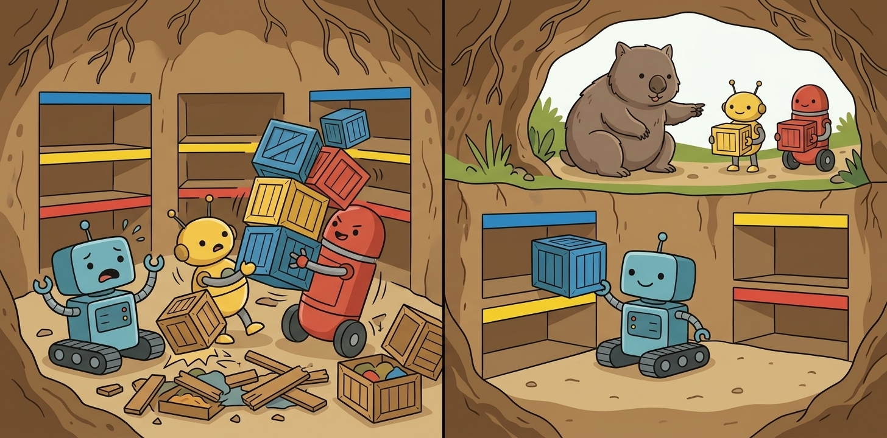
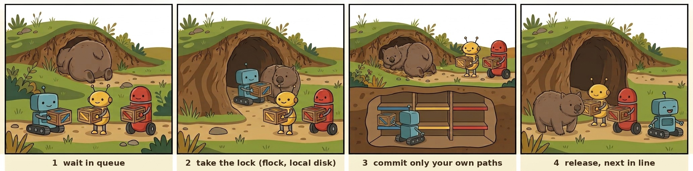

# 🐨 wombat-gate

<p align="center">
  
</p>

**One at a time through the burrow.** A commit queue for AI agents sharing one git
repository: they wait their turn, and each commits only its own files.

🌐 **English** · [中文](https://github.com/liyifreddy/wombat-gate/blob/main/README.zh-CN.md)

## 🚀 Quick start

```sh
pipx install git+https://github.com/liyifreddy/wombat-gate

wombat-gate commit -m "fix parser" -- src/parser   # commit only these paths, in turn
wombat-gate run -- git push                        # push
wombat-gate who                                    # who is in the burrow
```

One file, Python ≥ 3.8, standard library only. Linux, macOS and WSL.

In Claude Code, install the plugin (CLI + guard hook + rules for the agent):

```
/plugin marketplace add liyifreddy/wombat-gate
/plugin install wombat-gate@wombat-gate
```

## 😩 The problem

Put a few Claude Code sessions (or any agents) in one checkout and this happens fast:

- 🧺 **Commits take other people's files.** `git add -A`, `git commit -a` or a bare
  `git commit` sweeps in whatever a neighbour has staged. It bit us twice in two days.
- 🥊 **Lock fights.** Every index write needs `.git/index.lock`; the second agent gets
  `index.lock: File exists`. In our self-test, 8 writers × 15 commits landed 1–10 of 120.
- 🐢 **Every commit checks the whole tree.** On our 22k-file repo on a WSL-mounted Windows
  drive, one commit took 30–70 s and a busy queue waited 6 minutes. When memory runs low,
  those floods of disk requests fail first and take the drive down with them.
- 💣 **Whole-tree commands.** Agents reach for `git stash`, `git reset --hard`,
  `git checkout -- .` and throw away each other's work.

<p align="center">
  
</p>
<p align="center"><sub>Before: everyone in the burrow at once. After: one at a time, each crate on its own shelf.</sub></p>

## ✨ What you get

- ✅ **Your paths, nothing else.** `wombat-gate commit -m MSG -- PATH...` commits exactly
  those paths. Whatever others staged stays put.
- ✅ **A queue, not errors.** Everyone waits for one lock and goes in turn. Self-test:
  120 of 120 commits land; median wait 0.14 s on an idle machine.
- ✅ **No whole-tree scan.** Only your paths are touched. That 22k-file repo went from
  30–70 s to 3 s on its first real commit.
- ✅ **A guard hook** that stops whole-tree git commands in Claude Code (tested on 197 commands).
- ✅ **Hands off other people's locks.** If another git process holds one, it waits and retries.
- ✅ **Cleans up after itself.** If a wombat-gate gets killed while holding `index.lock`, the next
  commit spots its own leftover and removes it. Anyone else's lock is only reported:
  `wombat-gate doctor` says how old it is, who has it open, and what to do.
- ✅ **A timing log**: queue wait, lock hold and every git step, one JSON line per commit.
- ✅ **One-line install** as a Claude Code plugin, with the hook and a skill that teaches
  the agent the rules.

## 🕳️ Why a wombat

When a wombat is chased, it dives into its burrow and plugs the hole with its bottom —
a hard plate of bone that no fox can bite through. One wombat per burrow; everyone else
waits outside. (Wombats also leave cube-shaped poo on rocks to say *mine*. We feel the
same about our directories.)

```
  agent A ──┐                                      ┌──▶ commit A's paths only
  agent B ──┼──▶ queue ──▶ take lock ──▶ write ────┤
  agent C ──┘    (wait)    (local disk)            └──▶ release ──▶ next in line
```

<p align="center">
  
</p>

1. **Wait in queue** — agents line up outside.
2. **Take the lock** — one goes in. The lock lives under `~/.local/state`, outside the
   repo, on a local disk (wombat-gate warns if it isn't).
3. **Commit only your own paths** — it puts down its own crate and nothing else.
4. **Release, next in line** — out it comes; the next one goes in.

<p align="center"><sub>Illustrations generated with Google Gemini and edited by the author.</sub></p>

## 🧭 Under the hood

- **No stuck locks.** If the holder dies, the kernel drops the lock. Nothing to clean up.
- **Path checks.** `.`, the repo root, globs and `:` pathspecs are refused, so nobody
  commits the whole tree by accident.
- **Why it's fast.** Your paths are staged in a private copy of the index and grafted
  onto `HEAD`. The branch moves only if nobody else moved it, and git's own index lock is
  held the whole time. Every self-test run checks the result against plain `git commit`.
- **Status for your paths only**: `wombat-gate status -- PATH...`.
- **Human-only flags** (`--allow-broad`, `run --unsafe`) are refused inside agents.

The step-by-step version is in the [reference](REFERENCE.md).

## 🛠️ Usage

```sh
wombat-gate commit -m "parser: handle empty input" -- src/parser tests/test_parser.py
wombat-gate commit -n -m "..." -- src/parser   # dry run
wombat-gate status -- src/parser               # status of your paths only
wombat-gate run -- git push                    # push, fetch, tag, log, ... (an allow-list)
wombat-gate who                                # who is in the burrow
wombat-gate log -n 50                          # recent timings (--stats: p50 / p95)
wombat-gate doctor                             # git lock files: in use, stale, or ours
```

Set `WOMBAT_SESSION=agent-7` (or `--session`) so `who` can tell you who is in there.
Exit codes, settings and every refused command are in the [reference](REFERENCE.md).

## 🤖 With Claude Code

1. Install the plugin (see [Quick start](#-quick-start)). It brings the CLI, the guard hook
   and a skill with the rules.

2. Tell your sessions the rules, e.g. in `CLAUDE.md`:

   > Commit with `wombat-gate commit -m "..." -- <your paths>`; push with
   > `wombat-gate run -- git push`. No `git add -A`, `git commit -a` or `git stash`.

3. Mark Claude Code as an agent in `.claude/settings.json`, so the human-only flags
   (`--allow-broad`, `run --unsafe`) stay off: `{ "env": { "WOMBAT_NO_ESCAPES": "1" } }`.

Running many sessions? The [playbook](PLAYBOOK.md) covers naming, task cards, review
chains and unattended runs.

## ⚠️ Limits

- Only processes that use wombat-gate queue. Switch every agent over.
- The lock must be on a local disk. Windows-side git can't see a WSL lock.
- Commits get fast; `git status` and `git log` on a slow disk don't.
- Two agents changing the same file: the first commit takes both changes. Give agents
  separate paths.
- One machine only.

The full list is in the [reference](REFERENCE.md#limits-in-full).

## ✅ Self-test

```sh
python3 selftest_wombat_gate.py               # 1–7 min depending on load, throw-away repos on a local disk
python3 selftest_wombat_gate.py --mutants     # 44 past bugs put back; each must turn a check red
bash hooks/selftest_guard.sh                  # 197 commands the guard must block or let through
```

Every fast commit is compared with what plain `git commit` does on a copy of the repo.

## 📍 Status

- 0.8.0 candidate — staged deletion/rename support, reviewed file counts, checked worktree integration and release checks. See [CHANGELOG](CHANGELOG.md).

- 0.7.0 — cleans up its own stale `index.lock`; `doctor`; timing p50 / p95.
- 0.6.2 — before / after picture, language switch.
- 0.6.1 — illustrated README, a tiny wombat in `--help`, pipx packaging, PyPI workflow.
- 0.6.0 — fast commits (private index + tree graft + compare-and-swap).

How it's built and why: [DESIGN.md](DESIGN.md).

## 📄 License

MIT — see [LICENSE](LICENSE).

## Staged deletions, renames and reviewed counts (0.8)

Name both old and new paths for a rename, including when `git mv` or `git rm` has already staged the change. HEAD entries missing from the index are handled as deletions when the path is also absent on disk. A path still present on disk is staged from disk, as before.

```sh
wombat-gate commit -n --expect-files 2 -m 'rename notes' -- '旧目录/笔记.md' 'notes.md'
wombat-gate commit    --expect-files 2 -m 'rename notes' -- '旧目录/笔记.md' 'notes.md'
```

The preview shows one row per changed **path**, with both ends of a rename on separate rows. Filenames are JSON-quoted UTF-8, so embedded newlines cannot create extra rows. The summary `删 N / 改名 N / 改 N` means deleted paths excluding rename sources / rename pairs / other changed paths (including additions). A rename is two rows but one pair. `--expect-files N` checks the count again under the queue lock and refuses mismatches (exit 2); use the number of explicitly named changed files for a move. Directories expand recursively, so use the expanded file count rather than the number of directory arguments. Without the flag, the original recursive commit API remains available. Other agents' staging stays outside the selected paths.

## Integrate a worktree branch (0.8)

From the **target** worktree, rebase the committed source branch onto the current target HEAD, run the named checks in the source worktree, then fast-forward:

```sh
wombat-gate integrate -n --rebase topic --check 'python3 tests/run_all.py'
wombat-gate integrate    --rebase topic --check 'python3 tests/run_all.py' --check 'python3 tests/regression.py'
```

The source must already be checked out in a separate worktree and have no tracked changes or nonignored untracked files. At least one `--check` is required. Commands are split into argv without a shell: no pipes, redirection or shell expansion; `--check-timeout` defaults to 600 seconds per command. The repository's common queue covers rebase, checks and fast-forward. The target may have unrelated staged/unstaged work; overlapping tracked, untracked or ignored paths are refused. Ignored source files that target changes would overwrite are also refused. Checks must leave source HEAD and tracked/nonignored files unchanged.

Conflicts stop in the source worktree with the rebase state preserved; inspect it there and explicitly continue or abort before retrying. Failed checks leave the rebased source branch available and do not advance the target. Source branches containing merge commits require manual review. A changed target HEAD, an in-progress operation or unsafe overlap stops integration. There is no automatic stash, force update, conflict resolution, branch deletion or worktree deletion. Only cooperating processes share the queue; ordinary Git processes still need coordination.

## Platform status

| Platform | CLI support | This candidate's evidence |
|---|---|---|
| Linux | Supported (Python ≥3.8, Git, POSIX flock/signals) | Full suite runs on WSL's Linux kernel/ext4; separate native Linux host **not tested**. Linux CI configured, not yet run remotely. |
| WSL | Supported with Linux Git/Python; queue state on Linux local disk | Locally tested on WSL2. Stress fixtures on ext4; source on a Windows mount. Do not mix Windows Git writers with the WSL queue. |
| macOS | POSIX CLI supported; `/proc`-based lock opener diagnostics are limited | **Not tested locally**. Portable regression/guard/packaging CI configured. |
| Native Windows | Unsupported: fcntl/flock and POSIX signal timers required | **Not tested**; use WSL. A Windows Git process does not join the WSL lock. |

All platforms require Git with worktree and `merge/rebase --no-autostash` support for `integrate` (local validation: Git 2.43.0). No claim of independent testing on every platform is implied.

## Claude Code, Codex and OpenCode Go

The CLI works independently of a model/provider. These examples provide instructions plus explicit agent markers. Only the existing Claude Code plugin installs its guard hook; the Codex/OpenCode instructions are not a shell-enforcement hook.

**Claude Code:** install the plugin described above; add this project `.claude/settings.json` setting (merge it with existing settings), and put the commit rule in `CLAUDE.md`:

```json
{"env": {"WOMBAT_NO_ESCAPES": "1", "WOMBAT_SESSION": "claude-task"}}
```

```text
Commit only assigned files through wombat-gate. Preview a move with --expect-files N, name both old and new paths, and use the same count for the real commit. Stop if the file list differs. Integrate only a reviewed branch with the task's required --check commands. Ask before pushing or publishing when the task requires approval.
```

**Codex:** put that same rule in the repository's `AGENTS.md` ([official instructions guide](https://learn.chatgpt.com/docs/agent-configuration/agents-md)). Start it with:

```sh
WOMBAT_NO_ESCAPES=1 WOMBAT_SESSION=codex-task codex
# Example command for the agent:
WOMBAT_NO_ESCAPES=1 wombat-gate commit -n --expect-files 1 -m 'fix parser' -- src/parser.py
```

**OpenCode Go:** Go is a provider plan; the local OpenCode CLI uses the same project `AGENTS.md` rule ([official rules guide](https://opencode.ai/docs/rules/)). Start your configured OpenCode client with:

```sh
WOMBAT_NO_ESCAPES=1 WOMBAT_SESSION=opencode-task opencode
# Example command for the agent:
WOMBAT_NO_ESCAPES=1 wombat-gate commit --expect-files 1 -m 'fix parser' -- src/parser.py
```

The shared [skill](skills/wombat-gate/SKILL.md) also describes the workflow. Agent instruction/configuration examples were checked against documentation; all three full interactive clients were **not** launched in this validation. CLI marker and path protections are exercised in self-tests.

Release setup and the diagnosed PyPI `invalid-publisher` failure: [publishing guide](docs/PUBLISHING.md). A maintainer must configure the matching Trusted Publisher; changing YAML alone cannot create it.
