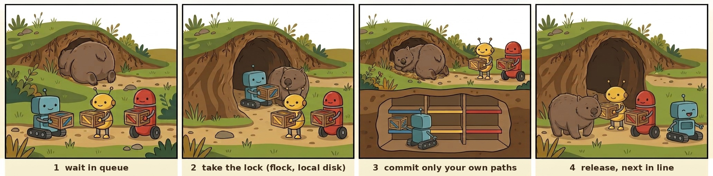

# 🐨 wombat-gate

<p align="center">
  
</p>

**一次只放一个进洞。** 几个 AI agent 共用一个 git 仓库时，让它们排队提交，而且每个只提交自己的文件。

🌐 [English](https://github.com/liyifreddy/wombat-gate/blob/main/README.md) · **中文**

## 🚀 快速上手

```sh
pipx install git+https://github.com/liyifreddy/wombat-gate

wombat-gate commit -m "修 parser" -- src/parser   # 只提交这些路径，排队轮流来
wombat-gate run -- git push                       # 推送
wombat-gate who                                   # 现在谁在洞里
```

一个文件，Python ≥ 3.8，只用标准库。Linux、macOS、WSL 都能用。

在 Claude Code 里装上插件（命令行 + 守卫 hook + 给 agent 的规矩）：

```
/plugin marketplace add liyifreddy/wombat-gate
/plugin install wombat-gate@wombat-gate
```

## 😩 遇到的问题

几个 Claude Code（或别的 agent）在同一个仓库里干活，很快就会碰到这些事：

- 🧺 **提交带走了别人的文件。** `git add -A`、`git commit -a`，或者不带路径的 `git commit`，会把别人暂存了一半的改动也一起提交。我们两天里碰到过两次。
- 🥊 **抢锁报错。** git 写索引前要先拿 `.git/index.lock`。两个进程同时来，后到的直接报 `index.lock: File exists`。自测里 8 个进程各提交 15 次，120 次只成功了 1–10 次。
- 🐢 **每次提交都把整个仓库检查一遍。** 我们的仓库有 2.2 万个文件，放在 WSL 挂载的 Windows 盘上，一次提交要 30–70 秒，高峰时排队等了 6 分钟。机器内存一紧，这种大量的读盘请求最先出错，整个盘跟着掉线。
- 💣 **agent 会用影响整个仓库的命令**，比如 `git stash`、`git reset --hard`、`git checkout -- .`，把别人的改动弄丢。

<p align="center">
  
</p>
<p align="center"><sub>之前：大家一起挤进洞。之后：一次一个，各放各的格子。</sub></p>

## ✨ 用了之后

- ✅ **只提交你点名的路径。** 别人暂存的东西原样留着，不会进你的提交。
- ✅ **排队，不报错。** 大家等同一把锁，轮到谁谁提交。自测 120 次全部成功；机器空闲时排队时间的中位数是 0.14 秒。
- ✅ **不再检查整个仓库。** 只处理你给的路径。上面那个 2.2 万文件的仓库，换用之后第一次提交只用了 3 秒（原来 30–70 秒）。
- ✅ **守卫 hook。** 在 Claude Code 里拦下影响整个仓库的 git 命令，用 197 条命令测过。
- ✅ **不碰别人的锁。** 碰到别的 git 进程占着锁，就等一会再试。
- ✅ **自己的残局自己收。** wombat-gate 拿着 `index.lock` 时被杀掉，下一次提交会认出这是自己留下的锁并删掉；别人的锁只报告不删：`wombat-gate doctor` 会告诉你锁放了多久、谁开着它、该怎么处理。
- ✅ **每次操作记一行日志**：排了多久、拿锁多久、每一步花了多久。
- ✅ **装起来简单。** Claude Code 插件一条命令装好，带守卫 hook 和教 agent 规矩的说明。

## 🕳️ 为什么叫袋熊

袋熊遇到危险会钻进洞里，用屁股把洞口堵住。它的屁股是一块很硬的骨板，狐狸咬不动。洞里一次只待一只袋熊。wombat-gate 也是这样：一次只让一个 agent 进 git。（袋熊的便便是方的，它会把便便摆在石头上标地盘。我们觉得自己的目录也该这么守。）

```
  agent A ──┐                                      ┌──▶ 只提交 A 自己的路径
  agent B ──┼──▶ 排队 ──▶ 拿锁 ──▶ 写 ─────────────┤
  agent C ──┘   （等）   （本地盘上的锁）           └──▶ 放锁 ──▶ 下一个
```

<p align="center">
  
</p>

1. **排队**：要提交的 agent 在外面排队。
2. **拿锁**：一次只进一个。锁放在 `~/.local/state` 下面，不在仓库里；这个目录要在本地盘上，不在的话 wombat-gate 会提醒。
3. **只提交自己的路径**：进去的那个只放下自己的箱子。
4. **放锁，下一个**：出来，下一个进去。

<p align="center"><sub>Illustrations generated with Google Gemini and edited by the author.</sub></p>

## 🧭 细节

- **锁不会卡死**：拿着锁的进程死了，系统会自动放锁，不会留下要手动删的锁文件。
- **路径检查**：`.`、仓库根目录、通配符、`:` 开头的特殊路径都不接受，免得一不小心提交整个仓库。
- **为什么快**：在索引的一份副本里只暂存你的路径，再把这些路径接到当前提交上；移动分支时先确认没有别人动过它；整个过程拿着 git 自己的索引锁，别的 git 进程插不进来。每次自测都和真正的 `git commit` 对比结果。
- **只看自己的状态**：`wombat-gate status -- 路径`。
- **给人用的开关**：`--allow-broad`、`run --unsafe` 在 agent 里一律拒绝。

一步一步的过程见 [REFERENCE.md](REFERENCE.md)（英文）。

## 🛠️ 用法

```sh
wombat-gate commit -m "parser: 处理空输入" -- src/parser tests/test_parser.py
wombat-gate commit -n -m "..." -- src/parser   # 只看会提交什么，不真提交
wombat-gate status -- src/parser               # 只看自己路径的状态
wombat-gate run -- git push                    # push、fetch、tag、log 等（白名单）
wombat-gate who                                # 现在谁在洞里
wombat-gate log -n 50                          # 最近的耗时记录（加 --stats 看 p50 / p95）
wombat-gate doctor                             # git 的锁文件：有人在用、像是残留，还是我们自己的
```

设 `WOMBAT_SESSION=agent-7`（或加 `--session`），`who` 里就能看到是谁。

## 🤖 在 Claude Code 里用

1. 在 `CLAUDE.md` 里写清楚：提交用 `wombat-gate commit -m "说明" -- 你的路径`，推送用 `wombat-gate run -- git push`；不要用 `git add -A`、`git commit -a`、`git stash`。
2. 装上守卫 hook（装插件就自带，见上面「快速上手」）。
3. 在项目的 `.claude/settings.json` 里加 `{"env": {"WOMBAT_NO_ESCAPES": "1"}}`。

## ⚠️ 局限

- 只有用 wombat-gate 的进程才会排队，所以所有 agent 都要换过来。
- 锁要放在本地盘上；Windows 那边的 git 看不到 WSL 里的锁。
- 只加快提交；`git status`、`git log` 在慢盘上还是慢。
- 两个 agent 改同一个文件，先提交的会把两边的改动一起带走。最好给每个 agent 分开的目录。
- WSL 内存用光时，Windows 盘可能掉线。这不是 wombat-gate 引起的，但耗时长的 git 命令最容易碰上。

## ✅ 自测

```sh
python3 selftest_wombat_gate.py               # 1–7 分钟，看机器忙不忙；在本地盘上建临时仓库
python3 selftest_wombat_gate.py --mutants     # 把 44 个修过的 bug 放回去，每个都必须被抓到
bash hooks/selftest_guard.sh                  # 197 条命令，逐条核守卫该拦还是该放
```

每次快速提交的结果，都会和在仓库副本上直接跑 `git commit` 的结果对比。

## 📍 版本

- 0.8.0 候选：已暂存删除 / 改名、文件数核对、带检查的 worktree 合回和发布校验。详见 [CHANGELOG](CHANGELOG.md)。

- 0.7.0：自己留下的 `index.lock` 自己收；`doctor`；耗时 p50 / p95。
- 0.6.2：之前 / 之后的图、语言切换行。
- 0.6.1：带图的 README、`--help` 里的小袋熊、pipx 打包、PyPI 发布流程。
- 0.6.0：快速提交（私有索引 + 嫁接 + 带旧值校验地移动分支）。

退出码、全部设置、每一条会被拒的命令见 [REFERENCE.md](REFERENCE.md)（英文）；设计思路见 [DESIGN.md](DESIGN.md)；多 session 怎么协作见 [PLAYBOOK.md](PLAYBOOK.md)。许可：MIT。

## 已暂存删除、改名与文件数核对（0.8）

改名要把旧、新路径都点名，已经 `git mv` / `git rm` 暂存也能提交。HEAD 里有、索引和磁盘都没有的路径按删除处理；磁盘还在的按原有规则暂存磁盘内容。

```sh
wombat-gate commit -n --expect-files 2 -m '笔记改名' -- '旧目录/笔记.md' 'notes.md'
wombat-gate commit    --expect-files 2 -m '笔记改名' -- '旧目录/笔记.md' 'notes.md'
```

预演每个发生变化的**路径**占一行，改名旧、新各一行。文件名用 UTF-8 JSON 引号表示，文件名里的换行不会多占一行。摘要「删 N / 改名 N / 改 N」分别是：不含改名源的删除路径数、改名对数、其他变化路径数（含新增）。一次改名占两行、一对。`--expect-files N` 会在队列锁内再次核数，不一致就退出 2；搬家时 N 写逐个点名的变化文件数。目录参数会展开，N 要写展开后的文件数，不是目录参数数。不加这个参数保留原有递归提交用法。选中路径以外，别人的暂存内容保持原样。

## worktree 分支合回主线（0.8）

在**目标** worktree 执行：先把已提交的源分支 rebase 到目标当前 HEAD，在源 worktree 跑点名检查，通过后目标只快进。

```sh
wombat-gate integrate -n --rebase topic --check 'python3 tests/run_all.py'
wombat-gate integrate    --rebase topic --check 'python3 tests/run_all.py' --check 'python3 tests/regression.py'
```

源分支必须已经在另一个 worktree 检出，没有受跟踪文件改动和非忽略的未跟踪文件。至少给一个 `--check`；命令拆成 argv 执行，不经过 shell，不支持管道、重定向、shell 展开；`--check-timeout` 默认每条 600 秒。两棵 worktree 共用仓库队列锁，覆盖 rebase、检查、快进。目标可以留着别人不重叠的暂存 / 未暂存内容；受跟踪、未跟踪和忽略文件与分支路径重叠都会拒绝。源里的忽略文件若会被目标改动覆盖也会拒绝。检查结束时源 HEAD 和受跟踪 / 非忽略文件必须不变。

冲突停在源 worktree，保留 rebase 状态，到那里检查后明确继续或中止再重试。检查失败保留已 rebase 的源分支，目标不前进。源分支有合并提交时交人工审；目标 HEAD 变化、已有进行中操作、路径重叠也会停。分支和 worktree 保留，不自动 stash、强改分支、解冲突或清理目录。普通 git 进程不共用队列，仍须协调。

## 平台支持

| 平台 | CLI 能否使用 | 本候选版证据 |
|---|---|---|
| Linux | 支持：Python ≥3.8、Git、POSIX flock / 信号 | 全套自测在 WSL 的 Linux 内核 / ext4 跑；独立原生 Linux 主机**没测**。已配 Linux CI，尚未远端运行。 |
| WSL | 支持，使用 Linux Git / Python，队列放 Linux 本地盘 | 本机 WSL2 实测，压力测试夹具在 ext4，源码在 Windows 挂载盘。不要混用 Windows Git 写入同一仓库。 |
| macOS | 支持 POSIX CLI；依赖 `/proc` 的锁持有者诊断有限 | 本机**没测**；已配可移植回归 / 守卫 / 打包 CI。 |
| Windows 原生 | 不支持：需要 fcntl/flock、POSIX 信号定时器 | **没测**；使用 WSL。Windows Git 不加入 WSL 的锁。 |

`integrate` 还要求 Git 支持 worktree 与 `merge/rebase --no-autostash`（本机验证 Git 2.43.0）。平台支持与独立实测结果分开列。

## Claude Code、Codex、OpenCode Go 接法

CLI 与模型、供应商无关。下面给项目规矩和明确的 agent 标记；只有现有 Claude Code 插件安装了守卫 hook，Codex / OpenCode 的文字规矩不是 shell 硬拦截。

**Claude Code**：照前面的方式装插件；把下面配置合入项目 `.claude/settings.json`，规矩写进 `CLAUDE.md`：

```json
{"env": {"WOMBAT_NO_ESCAPES": "1", "WOMBAT_SESSION": "claude-task"}}
```

```text
只通过 wombat-gate 提交卡上分配的文件。搬家先用 --expect-files N 预演，旧新路径都点名，再用同一个数真提交；文件清单不符就停。只合已验收分支，integrate 带卡点名的 --check。任务要求批准的推送和发布等批准再做。
```

**Codex**：同一段规矩放仓库 `AGENTS.md`（[官方说明](https://learn.chatgpt.com/docs/agent-configuration/agents-md)），这样启动：

```sh
WOMBAT_NO_ESCAPES=1 WOMBAT_SESSION=codex-task codex
# 交给 agent 的示例：
WOMBAT_NO_ESCAPES=1 wombat-gate commit -n --expect-files 1 -m '修 parser' -- src/parser.py
```

**OpenCode Go**：Go 是供应商计划，本机 OpenCode CLI 同样读取项目 `AGENTS.md`（[官方规矩说明](https://opencode.ai/docs/rules/)）。配置好供应商后这样启动：

```sh
WOMBAT_NO_ESCAPES=1 WOMBAT_SESSION=opencode-task opencode
# 交给 agent 的示例：
WOMBAT_NO_ESCAPES=1 wombat-gate commit --expect-files 1 -m '修 parser' -- src/parser.py
```

共用 [skill](skills/wombat-gate/SKILL.md) 也有操作规矩。上述配置 / 规矩按文档核对，三种完整交互客户端本轮都**没启动实测**；CLI 的 agent 标记和路径保护由自测验证。

发布设置及 PyPI `invalid-publisher` 原因见 [发布说明](docs/PUBLISHING.md)。维护者需要在 PyPI 建匹配的 Trusted Publisher，单改 YAML 不会代建账号设置。
